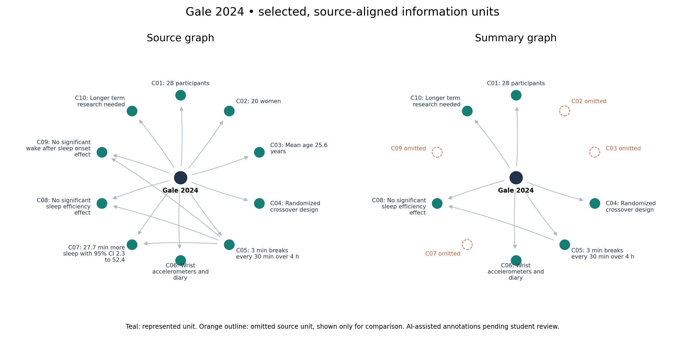
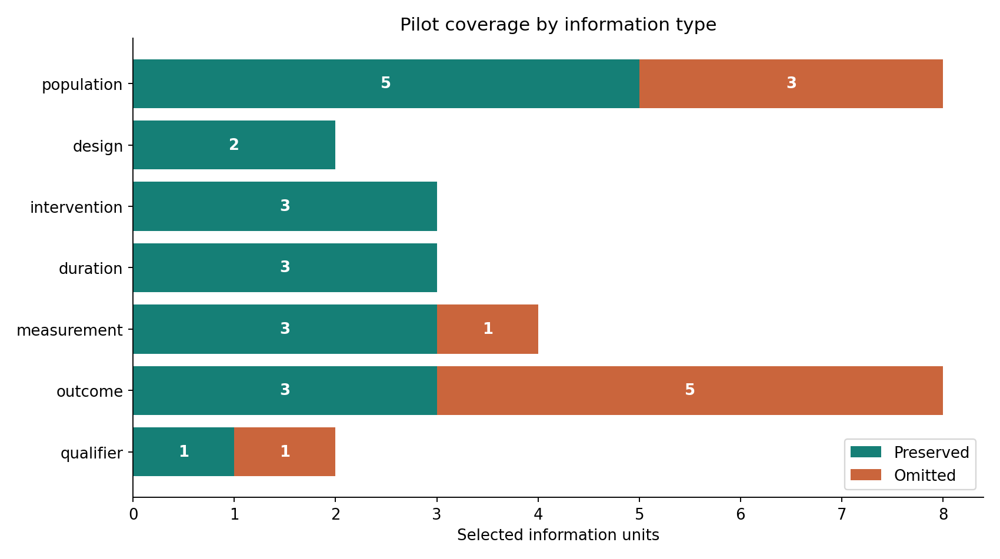
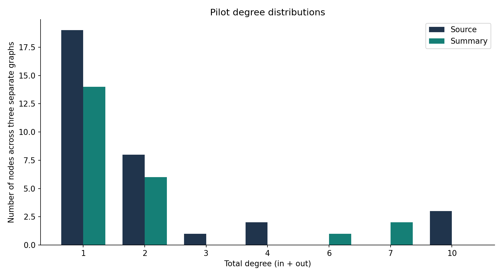

# Exercise and sleep summary omission pilot

Midterm first evidence for EM 626, AI/ML for Systems, Professor Carlo Lipizzi.

**Status:** three public abstracts, three saved AI-generated summaries, 30 AI-assisted provisional information-unit labels, six source-aligned graphs. **No trained GCN, predictive accuracy, clinical trust score or independent human annotation is claimed.**

## Run on Windows PowerShell, macOS or Linux

Python 3.10+ recommended. No API key, GPU or network access is needed to replay the pilot.

```sh
python -m venv .venv
```

Activate on Windows PowerShell: `.\.venv\Scripts\Activate.ps1`.
Activate on macOS/Linux: `source .venv/bin/activate`.

```sh
python -m pip install -r requirements.txt
python src/run_pilot.py
python -m unittest discover -s tests -v
```

If activation is restricted on Windows, use `.\.venv\Scripts\python.exe` in place of `python`.
A dependency-free validation/export run is available with `python src/run_pilot.py --no-plots`.

Open `results/interactive_graphs.html` in a browser. Inspect `results/results.json`, `graph_statistics.csv`, `annotation_review.csv`, PNG/SVG plots and GraphML files. All output is regenerated from `data/pilot.json`.

## What the first evidence actually shows

The saved summaries retain 20 of 30 selected information units and omit 10 under the provisional annotation scheme. These descriptive counts are conditional on our chosen units and summaries. They do not estimate general LLM performance. Source graphs cover the ten selected units per paper, not every fact in the abstract. Summary graphs project retained units into the same schema. Smaller summary graphs are expected by construction.

## Pilot graphs







## Repository map

- `data/pilot.json`: normalized source abstracts, citations, saved summaries and provisional aligned concepts.
- `data/provenance.json`: generation and annotation disclosures.
- `prompts/`: actual user-request record and reusable prompt templates.
- `src/run_pilot.py`: validation, graph construction, descriptive statistics, export and figures.
- `tests/test_pilot.py`: semantic integrity and output checks.
- `results/`: reproducible first evidence and review worksheet.
- `docs/`: midterm scope, pipeline, GCN plan, presentation notes, disclosure and GitHub instructions.

## Review before submission

Read each source abstract and summary. Complete reviewer columns in a COPY of `results/annotation_review.csv` outside `results/` because rerunning overwrites generated files. Resolve disagreements and edit the canonical records in `data/pilot.json` if needed. Rerun the script after edits and update presentation numbers. Evidence anchors validate occurrence, not medical meaning. Add the partner's name to the presentation and document. Rehearse the 10-minute talk and submit slides/document to Canvas in advance using the actual Canvas deadline.

## GCN is next

The planned GCN predicts preserved/omitted source concepts using source-graph connectivity, concept features and summary text representations. Preserved/omitted labels, summary node membership, graph differences and exact matching outputs must never enter GCN inputs. We will compare an MLP/logistic regression using the same non-graph inputs, plus a direct text-matching baseline. No training script is provided because training is outside this checkpoint.

## Source rights and citations

Baron et al. (2023), doi:10.3390/ijerph20085452, CC BY 4.0.
Gale et al. (2024), doi:10.1136/bmjsem-2023-001774, CC BY-NC 4.0.
Siu et al. (2021), doi:10.1001/jamanetworkopen.2020.37199, CC BY 4.0.

Original author rights apply to source abstracts. Text typography is normalized and AI summaries are adaptations. Keep attribution and the noncommercial restriction for Gale et al. No patient data. This academic prototype does not provide medical advice.

Code and annotations were drafted with the ChatGPT coding assistant in this session. Review `docs/AI_DISCLOSURE.md` and retain this conversation as part of the prompt record.
