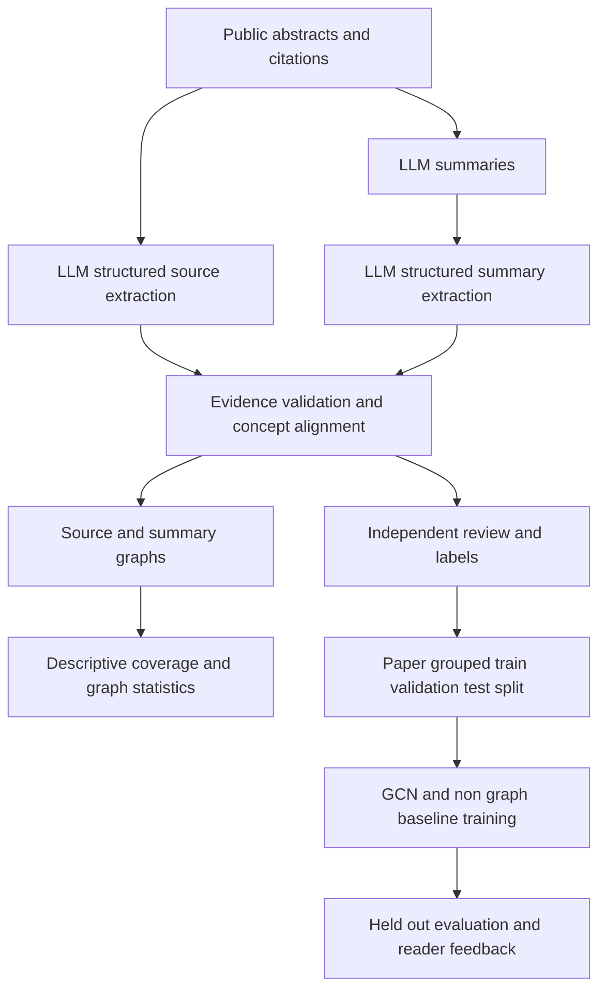

# Full pipeline and checkpoint boundary

Current checkpoint: A-G implemented as saved assistant-generated outputs and deterministic replay. Independent review H and trained evaluation I-K remain future work. The graph model uses source graph plus text features, never label-derived aligned graph differences.
